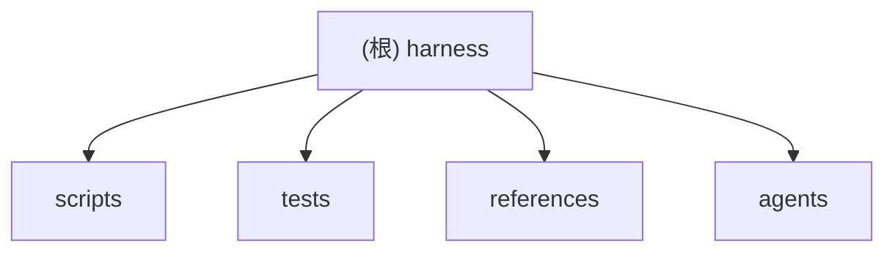

# Harness

## 变更记录 (Changelog)

| 时间 | 类型 | 说明 |
| --- | --- | --- |
| 2026-06-06 14:43:29 | 修复 | 修复 `detect_package_scripts` 绝对路径误跳过 bug；扫描器递归检测嵌套脚本并放开校验正则;新增 `truncated` 截断标记;新增 `scripts/check.sh` 作为统一检查入口。测试 23→27。 |
| 2026-06-06 13:12:21 | 增量复扫 | 全量复扫仓库，未检测到源文件、模块边界或文档内容变化；仅刷新时间戳与覆盖率元数据。 |
| 2026-06-05 20:33:44 | 初始化 | 扫描仓库并生成根级与模块级 Claude 工作文档。 |

## 项目愿景

`harness` 是一个 Codex Skill，用于接手陌生、老旧或大型仓库前，先把仓库事实沉淀为可验证文档和检查脚本。它的边界很清楚：先扫描事实，再写文档；不能验证的内容必须标注 `Needs human confirmation` 或 `Not configured`，不要猜架构、命令或所有权。

## 架构总览

这是一个小型 Python/Markdown 工具仓库，没有包管理器清单，也没有构建系统。核心由两个标准库 Python 脚本组成：

- `scripts/scan_repo.py`：扫描目标仓库，生成保守事实到目标仓库 `.agent/repo-facts.json`。
- `scripts/validate_harness_docs.py`：校验目标仓库是否具备最小 harness 文档、检查脚本和事实文件。

文档与模板定义 skill 的使用方式：

- `SKILL.md`：Skill 入口、触发条件、强制流程和反猜测规则。
- `README.md`：用户视角的功能说明、快速使用和开发说明。
- `AGENTS.md`：本仓库贡献者工作准则。
- `references/templates.md`：生成目标仓库 harness 文档时使用的模板。
- `agents/openai.yaml`：Agent 配置元数据。

## 模块结构图（Mermaid）



## 模块索引

| 模块 | 职责 | 语言/类型 | 入口 | 测试 | 配置 |
| --- | --- | --- | --- | --- | --- |
| `scripts/` | 仓库扫描与 harness 文档校验脚本 | Python | `scripts/scan_repo.py`, `scripts/validate_harness_docs.py` | `tests/test_harness_scripts.py` | Not configured: 无 `pyproject.toml`、`pytest.ini`、`ruff.toml` |
| `tests/` | 脚本行为回归测试 | Python unittest | `tests/test_harness_scripts.py` | 自身为测试模块 | Not configured |
| `references/` | 目标仓库 harness 文档模板 | Markdown | `references/templates.md` | 由校验脚本间接覆盖模板约束 | Not configured |
| `agents/` | Agent 界面元数据 | YAML | `agents/openai.yaml` | Not configured | `agents/openai.yaml` |

## 运行与开发

已验证存在的命令来自仓库文档，而不是包管理器清单：

```sh
python3 -m unittest tests/test_harness_scripts.py
python3 scripts/scan_repo.py /path/to/repo
python3 scripts/scan_repo.py --deep --limit 20000 /path/to/repo
python3 scripts/validate_harness_docs.py /path/to/repo
```

本仓库没有 `package.json`、`pyproject.toml`、`Makefile` 或 CI 配置。不要为了“看起来完整”引入 npm/pnpm/pytest/ruff，除非出现真实需求。

## 测试策略

- 测试框架：Python 标准库 `unittest`。
- 测试入口：`tests/test_harness_scripts.py`。
- 测试方式：使用临时目录构造目标仓库，验证扫描输出、文档校验、风险候选、缺失能力、脚本引用和反猜测规则。
- 修改脚本行为时，先补测试，再改脚本；否则就是在破坏已有用户行为。

## 编码规范

- Python 使用标准库、显式函数、保守扫描逻辑和 `Path` 对象。
- 保持确定性：不要从约定推断命令、owner、架构或安全边界。
- Markdown 要短、具体、可执行；不确定写 `Needs human confirmation`，明确不存在写 `Not configured`。
- 不要编辑生成物：`__pycache__/`、`.agent/`、`.claude/`、`.git/` 都不是业务源。

## AI 使用指引

1. 先读 `SKILL.md`、`README.md`、`AGENTS.md`，再动脚本。
2. 改 `scan_repo.py` 时必须考虑 `validate_harness_docs.py` 和测试夹具是否同步。
3. 改 `validate_harness_docs.py` 时必须补充接受与拒绝两类测试。
4. 不要把候选命令写成已验证命令；这是本仓库的核心纪律。
5. 对高风险词（auth、permission、billing、migration、secret、generated、public API）保持保守，宁可标候选也不要宣称安全。

## 扫描覆盖率

- 最近复扫时间：2026-06-06 13:12:21。
- 估算纳入扫描文件数：10 个非忽略文件。
- 已读取高信号文件数：9 个文本文件。
- 覆盖率：约 90%。
- 未读取/跳过：`.git/`、`.claude/`、`__pycache__/`、`*.pyc`，原因是忽略规则或二进制缓存。
- 与上次扫描差异：无源文件、模块边界或文档内容变化。

## 当前缺口

- 没有 CI 配置，发布前自动验证策略缺失。
- `scripts/check.sh` 已就位（运行 `python3 -m unittest tests/test_harness_scripts.py`）；尚无 CI 在提交时自动调用它。
- 没有 Python 项目清单或 lint/typecheck 配置；目前这是小仓库可以接受的简单状态，不要过早复杂化。
