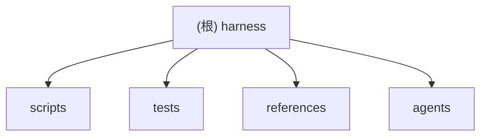

# Harness

## 变更记录 (Changelog)

| 时间 | 类型 | 说明 |
| --- | --- | --- |
| 2026-10-20 | 修复 | 扫描准确性修复：`--limit` 默认 50000，总数超过上限时按顶层目录比例配额 + 目录内等距抽样（git/非 git、`--force` 一致），不再按字母序截断漏扫整个目录；`truncated` 改为与真实总数比较；git 根级文件计入 `.`，`.agent/` 输出不再回流；去掉探测器内部 200/100 截断，`*_total`/`*_truncated`/`--full` 真实可信（Makefile 用解析器自身计数）；风险检测改为路径 token 匹配（拆 camelCase，长关键词允许前缀），一条路径可有多个原因，消除 `author`/`williams`/`prototype` 误报；校验器按 `RISK_MENTION_RULES` 覆盖 K8s/Helm/IAM/RBAC/PII/Stripe 并支持别名；`check.sh` 命令校验忽略注释、按整词匹配并扩充黑名单（jest/vitest/tox/gradlew/rspec 等）；CI 命令支持 GitLab/Bitbucket `script:` 列表与 CircleCI `run.command`，`.github/` 只认 `workflows/`、`actions/` 下的 YAML；git 不可用时回退 `os.walk`；忽略目录探测加 `--directory`；`package.json` 搜索剪枝 SKIP_DIRS；删除死代码 `extract_makefile_targets`、空 `parsers.py`；新增 `references/repo-facts.md` 字段说明并让 SKILL/模板引用新事实；`check.sh` 改跑全部测试；CI 增加 Python 3.13。新增 25 个测试，全部 165 个测试通过。 |
| 2026-07-27 | 功能 | 完成 issue #7 Slice 5：新增 `scripts/harness/content_detectors.py`，带共享 `ContentBudget`（默认 8 MiB，`--content-budget-bytes` 可调）的内容层探测：`extract_ci_commands`（GHA/GitLab/CircleCI 等 `run:` 单行命令 + `\|` 多行块首行，标 `multiline`）、`extract_dockerfile_directives`（RUN/CMD/ENTRYPOINT/WORKDIR/USER/EXPOSE）、`extract_tool_configs`（`pyproject.toml [tool.*]` 仅取 top-level 键名，覆盖 pytest/ruff/mypy/black/coverage.*）、`extract_env_keys`（仅 `.example`/`.sample`/`.template`，真实 `.env` 跳过并记 `parse_errors[kind=skipped_dotenv]`，永不读 value）、`extract_precommit_hooks_detail`（`repos[].hooks[].id`）、`extract_codeowners`、`extract_security_md`（前 200 字符摘要）；预算耗尽的文件记入 `content_read_truncated`；`scanner.py` 新增 `_dedupe_parse_errors` 消除同文件被多个探测器重复解析导致的 `parse_errors` 重复项；`schema.py` 补 `security_md`/`content_budget_bytes` 占位符。新增 24 个测试，全部 140 个测试通过。不读 README 命令块，不做 Python 入口探测（按 issue 要求留白）。 |
| 2026-07-27 | 功能 | 完成 issue #6 Slice 4：新增 `scripts/harness/task_parsers.py`（217行）；`extract_makefile_info` 支持 include 指令（深度≤2、visited 防循环）、`.PHONY` 标记、200 条限制；`extract_pyproject_scripts` 覆盖 `[project.scripts]`/`[tool.poetry.scripts]`/`[tool.pdm.scripts]`/`[tool.hatch.envs.*.scripts]`/`[tool.uv.workspace.members]`/`[tool.poetry.groups]`；`extract_cargo_info` 提取 workspace members + binary 名；`extract_go_work_modules` 解析 go.work；`extract_justfile_recipes` 正则解析；`_parse_yaml_section_keys` 无外部依赖受限 YAML，支持 Taskfile.yml 与 docker-compose.yml；`extract_workspace_packages`；`schema.py` 增 9 个占位字段；`scanner.py` 集成所有解析器并聚合 `parse_errors`；新增 34 个测试，全部 116 个测试通过。 |
| 2026-07-27 | 功能 | 完成 issue #5 Slice 3：`rules.py` 扩展语言规则表（Ruby/PHP/Elixir/C++/Bazel/asdf manifests）；新增 `MANIFEST_ECOSYSTEM` dict；`CI_CONFIG_NAMES` 增 Bitbucket/Drone/Woodpecker；`TEST_EXACT_FILENAMES` 支持 `conftest.py`；`GENERATED_HINTS` 增 `.gen.`/`_pb2.`/`.d.ts`/`__generated__`；`RISK_KEYWORDS` 增 IAM/RBAC/PII/Stripe/Terraform/K8s/Helm；`detectors.py` 新增 `detect_ecosystem_hypotheses()`；`scanner.py` 填充 `ecosystem_hypotheses` 字段替代占位符 `[]`。新增 29 个端到端测试，全部 82 个测试通过。 |
| 2026-07-27 | 修复 | code-review 修复：拆分 `test_harness_scripts.py`（746→319行）为 `helpers.py`、`test_git_traversal.py`、`test_harness_validate.py`；修复 `_os_walk_count_files` 在计数阶段错误构建 Path 对象（改用字符串切片）；`sample_with_buckets` 补全 `Callable`/`Any` 类型注解；消除 `doc_hints_raw` 提前声明；去除 `run_script` 重复定义。 |
| 2026-07-27 | 功能 | 完成 issue #4 Slice 2：两阶段扫描（`count_files` 先计数后遍历）；≤50k 全量、50k–500k 按顶层目录比例配额、>500k 抛 `FileLimitError`；`sample_with_buckets` 对所有候选字段限 500 条；新增 `total_files`/`top_level_file_counts`/`truncation_strategy`/`suggested_shards` 及各字段 `_total`/`_truncated` 元数据；`--full` 写全量 `repo-facts.full.json`；`--force` 强制越过 500k 限制。新增 18 个测试，全部 53 个测试通过。 |
| 2026-07-26 | 功能 | 完成 issue #3 Slice 1：`walk_repo` 改用 `git ls-files` 遍历 git 仓库；非 git 目录回退 `os.walk` + 扩展 SKIP_DIRS；新增 `submodules` / `ignored_top_dirs` 字段；补充 4 个端到端测试（git/非git/submodule/ignored_top_dirs）；修复 Windows `os.X_OK` 平台差异 skip。测试 35 个全部通过（1 个 Windows skip）。 |
| 2026-07-26 | 基建 | 完成 issue #2 prefactor：新增 `scripts/harness/` 包结构、薄 CLI、`schema_version: 2` 骨架、最小 `pyproject.toml` 与 GitHub Actions CI。 |
| 2026-06-06 14:43:29 | 修复 | 修复 `detect_package_scripts` 绝对路径误跳过 bug；扫描器递归检测嵌套脚本并放开校验正则;新增 `truncated` 截断标记;新增 `scripts/check.sh` 作为统一检查入口。测试 23→27。 |
| 2026-06-06 13:12:21 | 增量复扫 | 全量复扫仓库，未检测到源文件、模块边界或文档内容变化；仅刷新时间戳与覆盖率元数据。 |
| 2026-06-05 20:33:44 | 初始化 | 扫描仓库并生成根级与模块级 Claude 工作文档。 |

## 项目愿景

`harness` 是一个 Codex Skill，用于接手陌生、老旧或大型仓库前，先把仓库事实沉淀为可验证文档和检查脚本。它的边界很清楚：先扫描事实，再写文档；不能验证的内容必须标注 `Needs human confirmation` 或 `Not configured`，不要猜架构、命令或所有权。

## 架构总览

这是一个小型 Python/Markdown 工具仓库，带最小 `pyproject.toml` 和 GitHub Actions CI。核心由两个薄 CLI 入口和 `scripts/harness/` 标准库 Python 包组成：

- `scripts/scan_repo.py`：薄 CLI，解析参数后调用包内扫描函数，生成保守事实到目标仓库 `.agent/repo-facts.json`。
- `scripts/validate_harness_docs.py`：薄 CLI，解析参数后调用包内校验函数，检查最小 harness 文档、检查脚本和事实文件。
- `scripts/harness/`：扫描遍历、检测规则、schema v2 占位和文档校验实现。

文档与模板定义 skill 的使用方式：

- `SKILL.md`：Skill 入口、触发条件、强制流程和反猜测规则。
- `README.md`：用户视角的功能说明、快速使用和开发说明。
- `AGENTS.md`：本仓库贡献者工作准则。
- `references/templates.md`：生成目标仓库 harness 文档时使用的模板。
- `references/repo-facts.md`：`.agent/repo-facts.json` 字段说明。
- `agents/openai.yaml`：Agent 配置元数据。

## 模块结构图（Mermaid）



## 模块索引

| 模块 | 职责 | 语言/类型 | 入口 | 测试 | 配置 |
| --- | --- | --- | --- | --- | --- |
| `scripts/` | 仓库扫描与 harness 文档校验脚本 | Python | `scripts/scan_repo.py`, `scripts/validate_harness_docs.py` | `tests/test_*.py` | 最小 `pyproject.toml` 声明 Python >= 3.11；无 `pytest.ini`、`ruff.toml` |
| `tests/` | 脚本行为回归测试 | Python unittest | `python3 -m unittest discover tests` | 自身为测试模块 | Not configured |
| `references/` | 目标仓库 harness 文档模板 | Markdown | `references/templates.md` | 由校验脚本间接覆盖模板约束 | Not configured |
| `agents/` | Agent 界面元数据 | YAML | `agents/openai.yaml` | Not configured | `agents/openai.yaml` |

## 运行与开发

已验证存在的命令来自仓库文档，而不是包管理器清单：

```sh
python3 -m unittest discover tests
scripts/check.sh
python3 scripts/scan_repo.py /path/to/repo
python3 scripts/scan_repo.py --deep /path/to/repo
python3 scripts/validate_harness_docs.py /path/to/repo
```

本仓库有最小 `pyproject.toml`，仅声明项目名、版本和 Python >= 3.11；GitHub Actions CI 只跑 `python3 -m unittest discover tests`。不要为了“看起来完整”引入 npm/pnpm/pytest/ruff/mypy，除非出现真实需求。

## 测试策略

- 测试框架：Python 标准库 `unittest`。
- 测试入口：`python3 -m unittest discover tests`（`scripts/check.sh` 同此命令）。
- 测试方式：使用临时目录构造目标仓库，验证扫描输出、文档校验、风险候选、缺失能力、脚本引用和反猜测规则。
- 修改脚本行为时，先补测试，再改脚本；否则就是在破坏已有用户行为。

## 编码规范

- Python 使用标准库、显式函数、保守扫描逻辑和 `Path` 对象。
- 保持确定性：不要从约定推断命令、owner、架构或安全边界。
- Markdown 要短、具体、可执行；不确定写 `Needs human confirmation`，明确不存在写 `Not configured`。
- 不要编辑生成物：`__pycache__/`、`.agent/`、`.claude/`、`.git/` 都不是业务源。

## AI 使用指引

1. 先读 `SKILL.md`、`README.md`、`AGENTS.md`，再动脚本。
2. 改 `scan_repo.py` 时必须考虑 `validate_harness_docs.py` 和测试夹具是否同步。
3. 改 `validate_harness_docs.py` 时必须补充接受与拒绝两类测试。
4. 不要把候选命令写成已验证命令；这是本仓库的核心纪律。
5. 对高风险词（auth、permission、billing、migration、secret、generated、public API）保持保守，宁可标候选也不要宣称安全。

## 扫描覆盖率

- 最近复扫时间：2026-06-06 13:12:21。
- 估算纳入扫描文件数：10 个非忽略文件。
- 已读取高信号文件数：9 个文本文件。
- 覆盖率：约 90%。
- 未读取/跳过：`.git/`、`.claude/`、`__pycache__/`、`*.pyc`，原因是忽略规则或二进制缓存。
- 与上次扫描差异：无源文件、模块边界或文档内容变化。

## 当前缺口

- GitHub Actions CI 已就位，但只覆盖 Python 3.11/3.12 的 `unittest discover tests`，没有 lint/typecheck 阶段。
- `scripts/check.sh` 已就位（运行 `python3 -m unittest discover tests`，与 CI 一致）。
- 没有 lint/typecheck 配置；目前这是小仓库可以接受的简单状态，不要过早复杂化。

## Agent skills

### Issue tracker

Issues 和 PRD 使用 GitHub Issues 管理（`gh` CLI）。详见 `docs/agents/issue-tracker.md`。

### Domain docs

单上下文仓库 — 根级 `CONTEXT.md` + `docs/adr/`。详见 `docs/agents/domain.md`。
